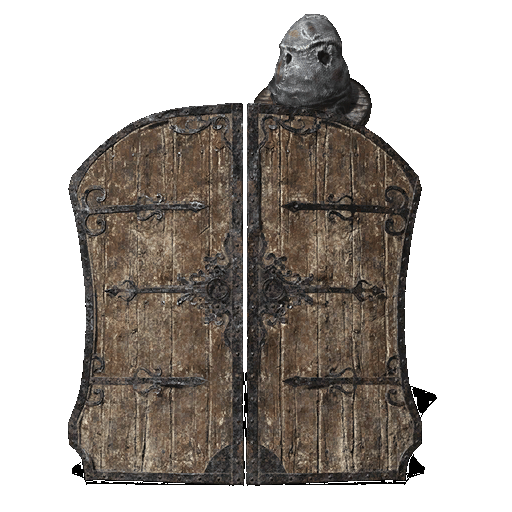

I'm a [third-year]{#phd-year} PhD student in the [Algorithms and Logic Group](https://tcsuestc.com/) @ University of Electronic Science and Technology of China (UESTC). My advisor is [Chao Xu](https://chaoxu.prof).

```{=html}
<script>
(() => {
    const now = new Date();
    // The academic year starts in September; enrollment was September 2024.
    const year = now.getFullYear() - 2024 + (now.getMonth() >= 8 ? 1 : 0);
    const words = ['first', 'second', 'third', 'fourth', 'fifth',
                   'sixth', 'seventh', 'eighth', 'ninth', 'tenth'];
    const suffixes = { one: 'st', two: 'nd', few: 'rd', other: 'th' };
    const rule = new Intl.PluralRules('en', { type: 'ordinal' }).select(year);
    const ordinal = words[year - 1] || (year + suffixes[rule]);
    document.getElementById('phd-year').textContent = ordinal + '-year';
})();
</script>
```

## paper {.unnumbered}

Authors are listed alphabetically.

- Sharp Bounds on the Number of Small Cuts  
  [Yu Cong, Chao Xu.  
  [arXiv:2609.10255](https://arxiv.org/abs/2609.10255)]{.paper-details}

- Destroying Rigidity in the Plane  
  [Yu Cong, Chao Xu, Yajie Zhao.  
  [arXiv:2610.38396](https://arxiv.org/abs/2610.38396)]{.paper-details}

- Derandomizing Karger's Contraction Algorithm for Matroids  
  [Yu Cong, Chao Xu, Yajie Zhao.  
  [arXiv:2608.16298](https://arxiv.org/abs/2608.16298)]{.paper-details}

- Integrality-Gap Bounds for Weighted Matchoids and Matroid Intersection  
  [Yu Cong, Yajie Zhao.  
  *IJTCSFAW 2026*. [arXiv:2609.21477](https://arxiv.org/abs/2609.21477)]{.paper-details}

- [[*with AI*]{.paper-era-above} [*without AI*]{.paper-era-below}]{.paper-era-divider}A Lagrangian Approach to Interdiction of Linear Minimization Problems  
  [Yu Cong, Kangyi Tian.  
  *IJTCSFAW 2026*. [arXiv:2604.23334](https://arxiv.org/abs/2604.23334)]{.paper-details}

- Large-Scale Trade-Off Curve Computation for Incentive Allocation with Cardinality and Matroid Constraints  
  [Yu Cong, Chao Xu, Yi Zhou.  
  *IJCAI 2025*. [arXiv:2609.20699](https://arxiv.org/abs/2609.20699)]{.paper-details}

<!-- 
```{=html}
<div class="gallery">

<pre class="ascii-art">
<a href="https://zh.wikipedia.org/zh-cn/%E8%94%A1%E5%BE%90%E5%9D%A4%E7%AF%AE%E7%90%83%E8%A7%86%E9%A2%91%E4%BA%8B%E4%BB%B6">
      //v\\
      ( 👀)
       _O_
  o==\  . /\\
 //  |\ ./] ||
🏀   [ || ]  o
     //  ||
     \\   \\ 
</a></pre>


</div>
``` -->
